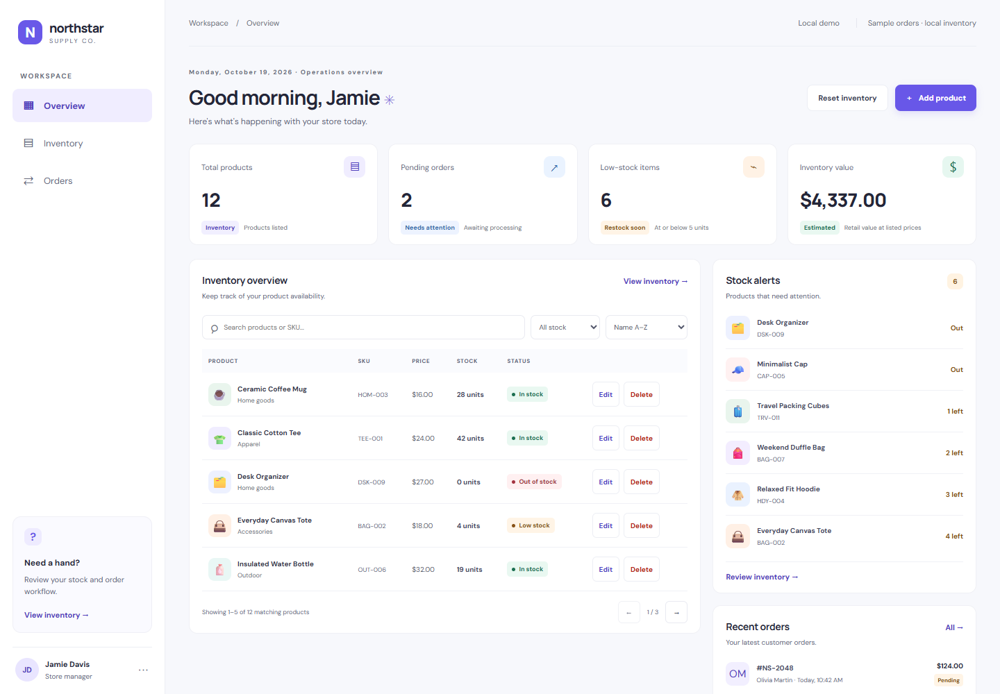
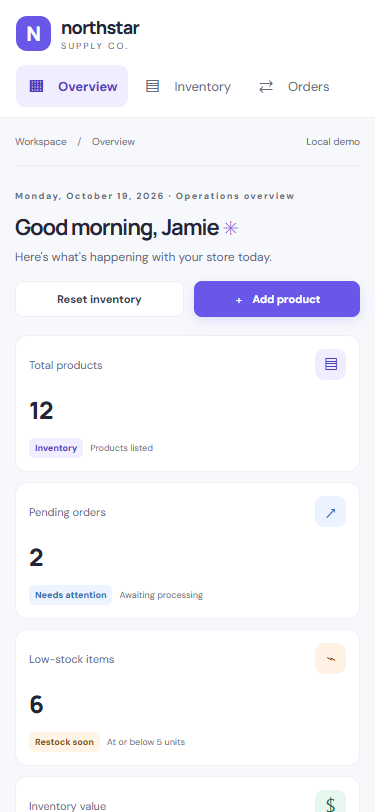
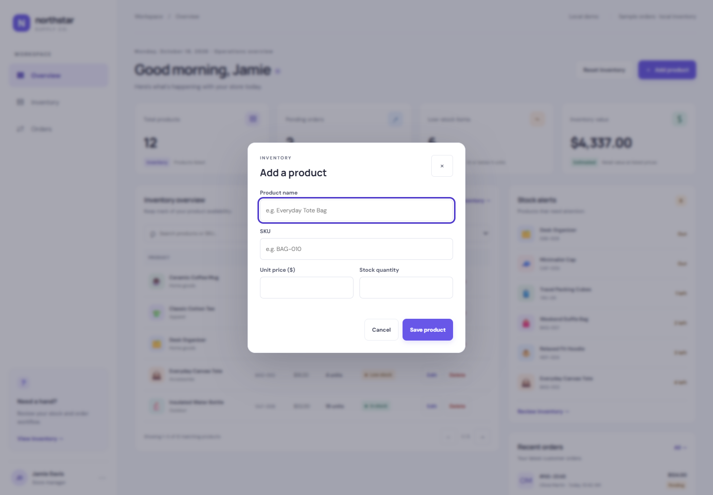

# E-commerce Operations Dashboard

A responsive inventory operations dashboard built as a React and TypeScript frontend prototype. It uses sample product and order data and stores inventory changes in the current browser; it does not connect to a backend.

## Features

- Dashboard summary metrics for total products, pending orders, low-stock items, and inventory retail value.
- Inventory table with stock status, low-stock alerts, and recent sample orders.
- Add, edit, and delete product workflows with input validation and duplicate-SKU prevention.
- Reset inventory to the original sample products, with confirmation.
- Search by product name or SKU, stock-status filtering, sorting, and pagination.
- Empty states for an empty inventory and searches with no matching products.
- Inventory persistence through browser `localStorage`, including validation of saved records and warnings when saved data cannot be read or updated.
- Responsive layout with a horizontally scrollable inventory table on narrow screens.
- Accessibility support including labeled form fields, product-specific Edit/Delete button names, keyboard-operable dialogs, visible focus styles, and dialog focus restoration.

## Technology stack

- React 19
- TypeScript 6
- Vite 8
- Oxlint
- Playwright Test for browser-based tests
- Native browser APIs, including `<dialog>`, `window.confirm()`, and `localStorage`

## Getting started

The project does not pin a Node.js version in its configuration. Use a Node.js and npm installation compatible with the installed Vite version.

From the project directory, install the locked dependencies and start the development server:

```sh
npm ci
npm run dev
```

Vite prints the local development URL in the terminal.

Create and preview a production build with:

```sh
npm run build
npm run preview
```

## Testing and quality checks

Run the project checks with:

```sh
npm run test:e2e
npm run build
npm run lint
```

The Playwright suite runs in Microsoft Edge (`channel: 'msedge'`) and starts a production build served by `vite preview` on `http://127.0.0.1:4173`. Edge must be installed. Tests use isolated browser contexts so inventory data does not carry between tests.

The tests cover product workflows and validation, filtering/sorting/pagination, empty inventory and page boundaries, localStorage persistence and recovery warnings, reset behavior, responsive checks at tablet/mobile widths, and keyboard accessibility. `tests/inventory-utils.spec.ts` also checks pure inventory helper functions through the existing Playwright runner; there is no separate unit-test command.

## Architecture

- `src/App.tsx` contains the dashboard presentation components and coordinates React state and user actions. It loads inventory, derives the table and summary data through utility functions, handles product mutations, and surfaces persistence warnings.
- `src/data/products.ts` defines the `Product` type and original sample inventory.
- `src/data/inventoryStorage.ts` owns the project-specific localStorage key, validates saved inventory records, loads inventory with recovery warnings, and saves inventory.
- `src/data/inventoryUtils.ts` contains inventory-related pure functions for product validation, stock status, filtering, sorting, pagination, and summary calculations.
- `tests/` contains Playwright end-to-end and inventory utility tests. `playwright.config.ts` builds the app and serves it for browser tests.

## Known limitations

- Product inventory and recent orders are demo data. Recent orders are sample records, not live orders.
- Inventory is stored only in browser `localStorage`. It is specific to the browser and site origin, is not shared across users or devices, and is not a shared database.
- There is no backend, authentication, server-side validation, or cross-device synchronization.
- If localStorage cannot be read or saved, the app displays fallback/session data and a warning; unsaved session changes may be lost on refresh.
- The project does not currently document or link to a public deployment.

## Screenshots

These screenshots were captured from the running local application in Microsoft Edge:

### Desktop dashboard (1440 × 1000)



### Mobile dashboard (375 × 812)



### Add Product dialog


